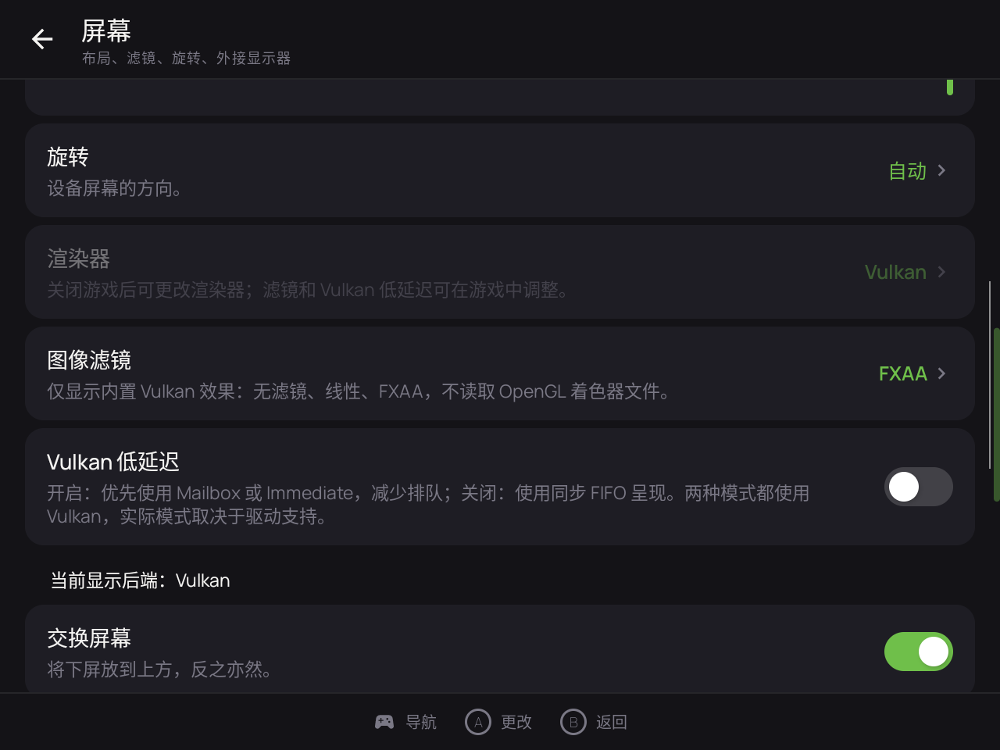

# SeedlessDS · 自制优化分支

基于 [SapphireRhodonite/SeedlessDS](https://github.com/SapphireRhodonite/SeedlessDS) 的 Android NDS 模拟器改进分支，侧重双屏布局、输入响应、可绑定回溯、存档可靠性与 Vulkan 呈现。当前版本：**1.0.11-shaders / versionCode 121**。

**特别感谢 SapphireRhodonite、WatermelonDS / SeedlessDS 制作组及所有贡献者开源与维护。** Vulkan 低延迟等优化参考了 [WatermelonDS 0.8.0.rc3](https://github.com/SapphireRhodonite/WatermelonDS/releases/tag/0.8.0.rc3)；完整归属见 [致谢](CREDITS.md)。这是第三方修改分支，自制版本号与官方发布相互独立。

[全部版本改进](CHANGELOG.md) · [最新滤镜与验证](SHADERS_1.0.11.md) · [许可](LICENSING.md) · [上游衍生英文说明](README.upstream-derived.md)

[下载最新测试版 APK（GitHub Releases）](https://github.com/yjhqq761261552-wq/seedless-ds-fork/releases/tag/v1.0.11-shaders)。感谢 OpenGL 滤镜的原算法作者与移植者，完整名单及源码依据见 [OpenGL / GLES 滤镜来源致谢](CREDITS.md#opengl--gles-滤镜来源)。

## 主要改进

- 添加了副屏幕悬浮窗模式，在4/3的机型上可以全屏幕展示，副屏固定在右下角，支持调整副屏大小与透明度，已在rp nova机型上进行测试。
- 修复了激烈模拟器核心带来的加速掉帧，现在支持不论几倍加速下都能输出60帧的画面，彻底告别了视觉上的卡顿。
- 添加了一键回溯功能：在“设置 → 按键”启用并绑定按键，支持按住回退；压缩移到后台，忙时跳过记录，采样间隔可调。
- 音频与存档：可选 AAudio、OpenSL 回退；异步存档完成反馈、失败恢复及成就状态关联检查。
- 呈现：屏幕菜单独立选择 OpenGL / Vulkan，默认 OpenGL；按后端筛选滤镜，仅 Vulkan 显示低延迟开关。
- 针对Vulkan渲染移植 共 16 项内置滤镜效果：无滤镜、线性、FXAA、LCD1x、zFast LCD、Sharp Bilinear、Sharp Shimmerless、Pixel AA Fast、LCD3x、Quilez，以及适用效果的 NDS Color 组合。
- 集成了社区常用游戏的金手指以及opengl下的滤镜

这里的 Vulkan 用于呈现软件渲染的 DS 帧，不代表新增 Vulkan 硬件 3D 模拟核心。低延迟开关关闭时使用 FIFO，开启时优先 Mailbox / Immediate，实际模式依驱动支持而定。运行中可改滤镜和低延迟，切换渲染器需关闭游戏。

## 界面截图

以下为 **1.0.9 的 Nova 实机历史截图**，展示渲染器、滤镜、低延迟开关与实际后端状态；图中的三个 Vulkan 滤镜属于当时版本，1.0.11 已扩充为 16 项。尚无 1.0.10 / 1.0.11 新滤镜的实机效果图。



## 版本索引

| 自制版本 | 改进重点 |
|---|---|
| 1.0.1 | 双屏比例、触控、shader 与线程同步修复 |
| 1.0.2 | 低延迟触摸、输入快照、多指和多来源输入 |
| 1.0.3 | 可绑定按键的回溯 |
| 1.0.4 | 左摇杆串键修复 |
| 1.0.5 | 后台回溯压缩与周期卡顿修复 |
| 1.0.6 | 合并官方 1.0.1 应用与核心更新 |
| 1.0.7 | Vulkan 低延迟呈现 |
| 1.0.8 | AAudio、短按保留、存档可靠性、双屏呈现优化 |
| 1.0.9 | 独立渲染器选项与滤镜兼容筛选 |
| 1.0.10 | Vulkan LCD1x / zFast LCD 与 NDS Color |
| 1.0.11 | 五个精选滤镜家族，Vulkan 共 16 项效果 |

每版详细改动与验证边界见 [CHANGELOG](CHANGELOG.md)，原始交付说明保存在 [docs/releases](docs/releases/)。

## 构建

本仓库包含实际 core 和原生依赖源压缩包，无需初始化 submodule。使用 JDK 17、Android SDK 35、Build Tools 34.0.0、NDK 25.2.9519653、CMake 3.22.1；Gradle 8.11.1 由 wrapper 获取。创建未跟踪的 local.properties，设置 sdk.dir。

```sh
./gradlew :app:assembleDebug :app:testDebugUnitTest :app:lintDebug
```

Windows 使用 gradlew.bat。首次构建需联网获取 Android/Gradle 依赖。普通 APK 构建使用随源 SPIR-V；重新生成 shader 的方法见 tools/compile_vulkan_shaders.py 和最新版本说明。

Debug 包名为 com.seedlessds.app.debug，支持 ARM64，最低 Android API 21；Vulkan 还需系统和驱动支持。随源 keystore 仅是公开的测试签名，不用于正式产品签名。APK 建议放在仓库 Releases，避免将二进制和构建缓存提交到源码历史。

## 验证范围

1.0.11 已完成构建、94 项 JVM 测试、原生检查和 shader 编译；Lint 为 0 错误 / 27 警告。1.0.7–1.0.9 的部分功能曾在 Nova 和虚拟外屏检查；1.0.10–1.0.11 新滤镜尚未实机验证。虚拟外屏检查不等于物理双屏测试；没有输入到像素的端到端延迟测量，也不承诺所有游戏满速。性能、画质与驱动兼容请以设备实测为准。

项目不包含游戏 ROM、用户存档或账号数据。许可沿用上游声明与各第三方原许可，见 [LICENSE](LICENSE)、[LICENSING.md](LICENSING.md) 与 [CREDITS.md](CREDITS.md)。
